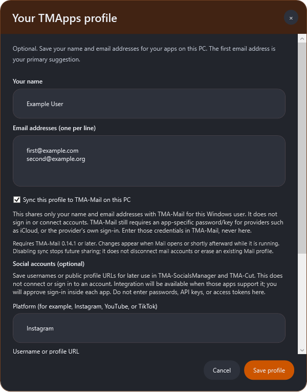

# TMApps Launcher

A launcher for **TMA-Mail** and **TMA-Agent Office**, available on **Windows, macOS, and Linux**. Windows keeps its existing native installer and interface; macOS and Linux use the companion desktop client. A burnt-orange navigation pane sits beside the app library, with version numbers, update dates, and Install / Open / Update controls. Downloads, verification, and app installation happen inside the launcher.


## Operating systems and downloads

| Launcher download | Architecture | Install |
| --- | --- | --- |
| [Windows Setup EXE](https://github.com/DaddyTylerXO/TMApps/releases/download/tma-apps/TMApps-Launcher-Setup.exe) | x64 | Run setup; existing 1.7+ launchers can use Check for updates. |
| [macOS DMG - Intel](https://github.com/DaddyTylerXO/TMApps/releases/download/tma-apps/TMApps-Launcher-1.11.1-mac-x64.dmg) | x64 | Open the disk image and drag the launcher to Applications. |
| [macOS DMG - Apple Silicon](https://github.com/DaddyTylerXO/TMApps/releases/download/tma-apps/TMApps-Launcher-1.11.1-mac-arm64.dmg) | ARM64 | Open the disk image and drag the launcher to Applications. |
| [Linux AppImage - Intel/AMD](https://github.com/DaddyTylerXO/TMApps/releases/download/tma-apps/TMApps-Launcher-1.11.1-linux-x64.AppImage) | x64 | Save in a writable location, allow execution, and open. |
| [Linux AppImage - ARM](https://github.com/DaddyTylerXO/TMApps/releases/download/tma-apps/TMApps-Launcher-1.11.1-linux-arm64.AppImage) | ARM64 | Save in a writable location, allow execution, and open. |

**Launcher support and app support are separate.** The Windows, Apple, and Linux logos under each app show the operating systems with published app builds. Both current app packages (**TMA-Mail and TMA-Agent Office**) are **Windows-only**. The Mac/Linux launchers display the library, profiles, settings, support badges, and release checks, and block incompatible EXE installations. Porting the launcher does not port the Mail or Office applications. Native app installation becomes available when that app has a verified package for the user's OS and CPU architecture.

The Mac/Linux client retains the burnt-orange navigation, List/Grid controls, search, movable navigation, optional local profile, startup preferences, tray support, and themed dialogs. Native app management supports checked tar.gz bundles/AppImages, custom install folders, per-app startup/desktop choices, close/force-close permission, and keep/delete data options. Existing Windows installations and Mail profile sync continue to use the native Windows client.

Native release checks run separately from the app catalog. Linux AppImage updates download and verify the matching architecture, keep a previous-image backup, replace a writable AppImage, and restart. macOS updates download and verify the matching DMG, then open it for the user to quit and replace the app in Applications. Profile/library data stay outside the installed application. macOS builds are ad-hoc signed but are not Developer ID signed or notarized; macOS may require user approval before opening. Linux tray visibility depends on the desktop; close-to-tray is off by default on Linux.

CI builds and checks the launcher on **macOS 15 and Ubuntu 24.04, x64 and ARM64**, including the packaged apps. Linux requires a graphical desktop and the usual Electron system libraries. If an AppImage cannot mount because FUSE is unavailable, its `--appimage-extract-and-run` mode can be used without changing the launcher or catalog.

## Optional profile and TMA-Mail sync

Click the circular **profile icon at the top right** to save a name and up to 20 email addresses, one per line. The first address is the primary suggestion. This setup is optional; the launcher works without a profile. The avatar shows your initial after saving.

On Windows, enable **Sync this profile to TMA-Mail on this PC** to share the name and account-setup suggestions with **TMA-Mail 0.14.1 or later** for the current Windows user. Mail reads changes at startup and within a few seconds while running. Connected mailbox identities and credentials remain separate. This is local sharing, not cloud/device sync or a sign-in service.

**A saved profile does not connect email accounts.** In TMA-Mail, choose the saved address and enter that provider's app-specific password/key (for example, iCloud) or complete its provider sign-in. The launcher does not ask for or transfer passwords, keys, or authentication tokens. The same explanation appears on the profile options page.

Cancel discards profile edits. Disabling sync stops future sharing and removes Mail's imported address suggestions; an existing Mail display name and connected accounts remain. You can erase the launcher's saved name/addresses by clearing the fields, disabling sync, and saving.

Shared profile data is stored at `%LOCALAPPDATA%\TMApps\profile.json`, separately from Mail's account store and the launcher installation. Custom Mail data profiles are isolated by default; `--launcher-profile <path>` explicitly opts one in for controlled use/testing.



## Windows installation

Download [**TMApps-Launcher-Setup.exe**](https://github.com/DaddyTylerXO/TMApps/releases/download/tma-apps/TMApps-Launcher-Setup.exe) and run it. Setup installs the launcher for your Windows user, creates a Start menu entry, and adds a normal Windows Apps uninstall entry. No ZIP extraction, administrator access, or developer tools are needed. Requires Windows 10/11 x64 with .NET Framework 4.8. Builds are currently unsigned.

During setup choose **Open when I sign in to Windows**, **Create a desktop icon**, **Stay in the tray when the window is closed**, and whether to open the launcher immediately. The default installation folder is `%LOCALAPPDATA%\Programs\TMApps Launcher`. Re-run setup to upgrade; first quit the running launcher using its tray menu. Preferences and installed application data are preserved.

**Install location → Browse** selects a different launcher folder, including another drive. You can also type a full path. Choose an empty folder you can write to; setup remembers the registered location for upgrades and points shortcuts, Windows startup, and the uninstaller at that location. Selecting a new folder during setup relocates the launcher while keeping its separate profile.

The rocket tray icon has **Open launcher**, **Check for updates**, and **Quit** actions. Double-click to reopen a hidden launcher. Turn off close-to-tray in Settings if closing the window should exit instead. Opening the installed launcher again restores an existing hidden instance.

The launcher uses a white rocket on a rounded burnt-orange (`#CC5500`) tile, embedded as a multi-resolution Windows executable icon and shown in the title bar and launcher header. Rounded controls and panels follow TMA-Mail's dark theme. File Properties lists **DaddyTylerXO** as Company. This metadata is separate from Windows' verified publisher: code signing is deferred, so SmartScreen can still display **Unknown publisher** and an unrecognised-app warning. A trusted signing identity and publisher reputation are needed for that; a self-signed certificate does not solve public distribution trust. See [Microsoft's signing guidance](https://learn.microsoft.com/en-us/windows/apps/package-and-deploy/code-signing-options).

The release is created by the [Cross-platform launcher and app catalog workflow](https://github.com/DaddyTylerXO/TMApps/actions/workflows/publish.yml). Check that workflow for the first build's status if the release is not available yet.

**Public downloads are available without a GitHub account or token.** Both application packages and the release catalog can be downloaded directly. If you previously connected a GitHub token, choose **Settings → Disconnect GitHub** to use public downloads. Optional token support remains available if private access is needed later; saved tokens are encrypted for your Windows user and removed on disconnect.

- **Install app** downloads a Windows ZIP and verifies its SHA-256 checksum before extraction.
- Before a new app installation, choose its destination using **Browse** or enter a full folder path, then confirm **Install**. Cancel closes the prompt without starting a download. Each app can use a different folder or drive. Updates reuse the saved location; existing installations from older launcher versions retain their locations.
- The app-install prompt also offers **Open app on Windows start-up** (off by default) and **Create desktop icon** (on by default). These apply to the app being installed. The launcher remembers the choices, updates their executable targets after an app update, and removes its managed startup entry/shortcut when that app is uninstalled.
- Updating or uninstalling a running app opens a themed permission popup, including when it is hidden in the tray. Save your work before allowing it to close. If it stays open, a separate **Force close** confirmation warns about unsaved work; Cancel leaves the operation untouched. Only processes under the selected managed install location are closed.
- **Uninstall** defaults to **Keep local data**. Choose **Delete local data permanently** to remove accounts, settings, caches, and profile-contained projects from `%LOCALAPPDATA%\TMA-Mail` or Agent Office's `%APPDATA%\agent-office` / `%APPDATA%\Agent Office` profiles. This affects all copies for the current Windows user, so other running copies must be closed first. Server mail, external work folders, and custom `--data-dir` profiles are kept. The popup shows the exact standard folders before confirmation.
- **Open app** starts the installed executable. The options menu also opens an older installed version while an update is available.
- **Check for updates** fetches the current application catalog. **Update app** installs the newer build when you choose it. It also checks TMApps Launcher itself. If a newer launcher is available, choose **Update and restart** in the orange/grey popup. The launcher downloads and verifies the installer, hands over to setup, updates in the same folder, and reopens with settings and installed apps preserved. Cancel leaves your current version in place. Launcher update checking works even if the app catalog check fails.
- In-app launcher updates require the installed launcher (Start menu/desktop shortcut). Install **1.7.0 or later once** to enable this feature; older launchers cannot discover their own update. Future launcher releases will then be offered within the app. Updates are user-approved and may still be subject to the unsigned-build Windows prompts described above.
- Mail update checks also inspect the `TMA-Mail` branch's `update.json` and package checksum at one pinned Git commit. A new branch package can appear before the shared release catalog is republished. Numeric version comparison recognises `0.10.0` as newer than `0.9.2`; known newer cached versions are retained if the shared catalog is stale. An incomplete branch check is reported instead of claiming everything is up to date.
- Search, **Installed** / **Updates** / **Not installed** filters, and explicit **Grid** / **List** buttons help navigate the library. The selected view is saved.
- **Settings → Appearance** moves navigation to **Left**, **Top**, **Right**, or **Bottom**, just like TMA-Mail, and offers a compact icon ribbon. The ☰ button collapses or expands navigation. Appearance changes preview immediately; Cancel reverts them and Save keeps them.
- **Settings → Startup** changes Windows startup, desktop shortcut, close-to-tray, and startup release-check options after installation.
- Every app shows its current published version and source update date. Publishing records the Mail package's last source commit date and Agent Office's source commit date; rebuilding the launcher does not invent a new app update date.
- App options open its source, show its installation folder, or uninstall its managed binaries. Separate app accounts, mail, and workspace profiles are retained.
- Settings can disable startup release checks. Updates download only when clicked.

Applications installed independently are not automatically adopted. Install them through the launcher to manage their versions here. Close an application before updating or uninstalling it.

## Application sources and readiness

| Application | Source branch | Bundled fallback |
| --- | --- | --- |
| TMA-Mail | [TMA-Mail](https://github.com/DaddyTylerXO/TMApps/tree/TMA-Mail) | 0.10.0-beta package pinned to its source commit with SHA-256 verification |
| TMA-Agent Office | [TMA-AgentOffice](https://github.com/DaddyTylerXO/TMApps/tree/TMA-AgentOffice) | Published 0.2.0 package with SHA-256 verification |

The publishing workflow copies the newest checked-in Mail ZIP after verifying its checksum and builds Agent Office's unpacked Windows Electron app using its lockfile. Both ZIPs and checksums upload before `catalog.json`. The launcher reads that catalog from this repository's `tma-apps` GitHub Release. If publication fails, Mail can still install from the bundled fallback; Agent Office is never shown as installable without a package.

Application-specific setup still applies. TMA-Mail's Microsoft/Google browser sign-in needs publisher OAuth configuration as described on its branch. Agent Office's AI features require the corresponding provider connection. The launcher does not supply credentials or change app features.

## Build and test

The Windows launcher build needs neither Node.js nor a separate .NET SDK:

```powershell
.\build.ps1
.\test.ps1
.\package.ps1
& '.\build\TMApps-Launcher.exe'
```

The build uses the Windows .NET Framework C# compiler and WPF, with no external installer compiler. Tests cover the installation engine, a real installer payload install/launch/uninstall in an isolated folder, real routed Install and three-dot clicks, saved Grid/List controls, all four navigation positions, compact mode, and WPF rendering. The preview is `build/launcher-preview.png`. Packaging creates `dist/TMApps-Launcher-Setup.exe` and its checksum; users download only the setup EXE. The installed runtime remains a single `TMApps-Launcher.exe` with its UI, icon, and initial catalog embedded.

`make-icon.ps1` regenerates the original vector rocket as PNG and a seven-resolution ICO (16–256 px) under `assets/`. The icon is compiled into the EXE; no separate image download is required.

The GitHub button uses the official [Octicons GitHub mark](https://github.com/primer/octicons), rendered as a vector inside the same bubble button style as Settings and Check updates. Its MIT license is preserved in `assets/github-mark-LICENSE.txt`.

For the macOS/Linux companion, use Node.js 24 and pnpm 10 on the target OS:

```sh
cd desktop
pnpm install --frozen-lockfile --ignore-scripts
node node_modules/electron/install.js
cp ../catalog.json catalog.json
pnpm test
pnpm exec electron .
# On macOS: pnpm exec electron-builder --mac dmg --arm64 --publish never
# On Linux: pnpm exec electron-builder --linux AppImage --x64 --publish never
```

Use `--x64` or `--arm64` to match the native host. CI performs the source and packaged smoke checks on all four native targets, then publishes the installers before `launcher-platforms.json`. The Windows updater continues using its existing `launcher-update.json` contract.

App OS badges default to Windows for older catalogs. New catalogs can supply `platforms` using `windows`, `macos`, and `linux`. Native installation requires a verified entry in `packages`, keyed by `macos-x64`, `macos-arm64`, `linux-x64`, or `linux-arm64`, with `url`, `sha256`, `format` (`tar.gz` or Linux `appimage`), and a relative `executable` path. Only advertise a platform after its app package has been built, tested, and uploaded; do not add Mac/Linux badges merely because the launcher itself supports them.

## Publish updates

Push launcher changes to `TMApps-Launcher`, or manually run **Publish launcher for Windows, macOS and Linux** from GitHub Actions. Actions must be enabled with the workflow's `contents: write` permission. No external secrets are needed for this public repository. Each run builds the current application branches. To release Mail, commit its newer ZIP and `.sha256` sidecar to `TMA-Mail/dist/`. For Agent Office, update its package version and lockfile on `TMA-AgentOffice`. Then rerun the launcher workflow. Source-branch pushes alone do not trigger the workflow on this branch.

The catalog requires exactly the two registered app IDs, fixed executable names, semantic versions, HTTPS download URLs within this repository, and SHA-256 checksums. Add another app by extending the catalog validation, UI metadata, and workflow together. Only publish trusted builds: checksums detect damaged/mismatched packages but are not publisher code signatures.

## Storage and installation safety

Preferences, the cached catalog, and app installation records live in `%LOCALAPPDATA%\TMApps\Launcher`. Each app's binaries live in a version folder under its selected installation directory; the default for new apps is `%LOCALAPPDATA%\Programs\<app-name>`. The installation record stores that directory. Older installations under `apps/<app-id>/` remain supported. Downloads extract into a new version folder. The record switches atomically after verification, extraction, executable checks, cancellation checks, and checking the app is closed. Failed/cancelled updates preserve the previous record. ZIP traversal paths, links, excessive file counts, and oversized packages are rejected.

Install and uninstall work for the current Windows user without administrator access, using writable destination folders. Drive roots and unrelated nonempty folders are rejected. Updates remove only the previously recorded version folder, and app uninstall removes only the active recorded version, preserving other files and folders at the chosen location. An interrupted installation can leave an inactive staging folder. If an app cannot be closed through its permission popup, close it manually before retrying locked-file errors. Update the launcher through Check for updates, or re-run setup for repair/manual upgrades. Uninstall it through Windows Apps or its installed `Uninstall.exe`, including from custom locations; launcher-managed applications and profile data are kept.


## TMA-Safe integration (1.11.0)

TMA-Safe is the third app in the library, with purple styling and a key icon. The catalog advertises only published, checksummed OS packages. Its own release workflow publishes Windows, macOS and Linux packages and updates the shared catalog. Existing two-app caches remain readable; refresh accepts the third app. Launcher uninstall never deletes user-selected password vaults or key files. Update older launchers before using the three-app catalog.


## TMA-Padlock integration (1.11.0)

Padlock is the fourth app, styled pink with a lock icon. Its release workflow publishes checksummed packages for Windows x64, macOS x64/arm64, and Linux x64/arm64. Until those builds pass, it appears without an install package. Uninstall preserves its encrypted vault in the OS application-data folder. Refresh accepts legacy catalogs and four-app catalogs.


The library keeps TMA-Agent Office last. Its number follows the full library order (currently 04), including in filtered views. TMA-Mail uses its official app icon in both library layouts.
