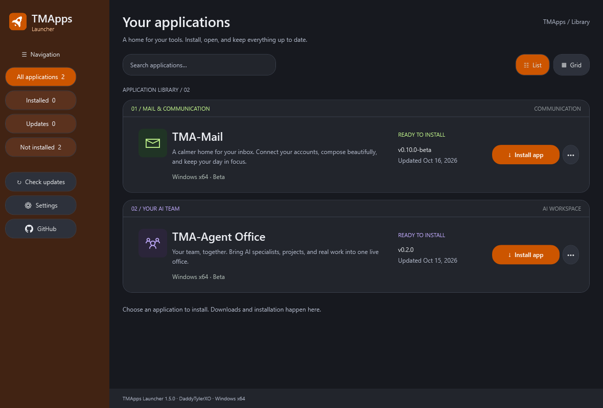

# TMApps Launcher

A native Windows home for **TMA-Mail** and **TMA-Agent Office**. Install applications, open them, and apply updates from one dark, green-accented library. Inspired by the supplied reference, with original TMApps branding and visuals.



## Download and run

Download **TMApps-Launcher-1.0.0-windows-x64.zip** from [Windows downloads](https://github.com/DaddyTylerXO/TMApps/releases/tag/tma-apps), extract the entire folder, and run **TMApps Launcher.exe**. Keep its XAML, config, and catalog beside it. Requires Windows 10/11 x64 with .NET Framework 4.8. Builds are currently unsigned.

The release is created by the [Publish Windows launcher and app catalog workflow](https://github.com/DaddyTylerXO/TMApps/actions/workflows/publish.yml). Check that workflow for the first build's status if the release is not available yet.

**Public downloads are available without a GitHub account or token.** Both application packages and the release catalog can be downloaded directly. If you previously connected a GitHub token, choose **Settings → Disconnect GitHub** to use public downloads. Optional token support remains available if private access is needed later; saved tokens are encrypted for your Windows user and removed on disconnect.

- **Install app** downloads a Windows ZIP and verifies its SHA-256 checksum before extraction.
- **Open app** starts the installed executable. The options menu also opens an older installed version while an update is available.
- **Check for updates** fetches the current application catalog. **Update app** installs the newer build when you choose it.
- Search, **Installed** / **Updates** filters, and grid/list views help navigate the library.
- App options open its source, show its installation folder, or uninstall its managed binaries. Separate app accounts, mail, and workspace profiles are retained.
- Settings can disable startup release checks. Updates download only when clicked.

Applications installed independently are not automatically adopted. Install them through the launcher to manage their versions here. Close an application before updating or uninstalling it.

## Application sources and readiness

| Application | Source branch | Bundled fallback |
| --- | --- | --- |
| TMA-Mail | [TMA-Mail](https://github.com/DaddyTylerXO/TMApps/tree/TMA-Mail) | Existing 0.8.0-beta ZIP, pinned to its exact commit and checksum |
| TMA-Agent Office | [AI-Agent-Dashboard](https://github.com/DaddyTylerXO/TMApps/tree/AI-Agent-Dashboard) | 0.2.0 metadata; **Coming soon** until a real package is published |

The publishing workflow copies the newest checked-in Mail ZIP after verifying its checksum and builds Agent Office's unpacked Windows Electron app using its lockfile. Both ZIPs and checksums upload before `catalog.json`. The launcher reads that catalog from this repository's `tma-apps` GitHub Release. If publication fails, Mail can still install from the bundled fallback; Agent Office is never shown as installable without a package.

Application-specific setup still applies. TMA-Mail's Microsoft/Google browser sign-in needs publisher OAuth configuration as described on its branch. Agent Office's AI features require the corresponding provider connection. The launcher does not supply credentials or change app features.

## Build and test

No Node.js or separate .NET SDK is needed for the launcher:

```powershell
.\build.ps1
.\test.ps1
.\package.ps1
& '.\build\TMApps Launcher.exe'
```

The build uses the Windows .NET Framework C# compiler and WPF. Tests cover catalog validation, version ordering, archive boundaries, checksum failures, cancellation, install detection, atomic state writes, uninstall data retention, catalog recovery, and actual WPF template rendering. The preview is `build/launcher-preview.png`. Packaging creates the distributable ZIP and checksum under `dist/`.

## Publish updates

Push launcher changes to `TMApps-Launcher`, or manually run **Publish Windows launcher and app catalog** from GitHub Actions. Actions must be enabled with the workflow's `contents: write` permission. No external secrets are needed for this public repository. Each run builds the current application branches. To release Mail, commit its newer ZIP and `.sha256` sidecar to `TMA-Mail/dist/`. For Agent Office, update its package version and lockfile on `AI-Agent-Dashboard`. Then rerun the launcher workflow. Source-branch pushes alone do not trigger the workflow on this branch.

The catalog requires exactly the two registered app IDs, fixed executable names, semantic versions, HTTPS download URLs within this repository, and SHA-256 checksums. Add another app by extending the catalog validation, UI metadata, and workflow together. Only publish trusted builds: checksums detect damaged/mismatched packages but are not publisher code signatures.

## Storage and installation safety

Preferences and the cached catalog live in `%LOCALAPPDATA%\TMApps\Launcher`. Binaries live under `apps/<app-id>/<unique-install-folder>/`. Downloads extract into a new folder. The installation record switches atomically after verification, extraction, executable checks, cancellation checks, and checking the existing app is closed. Failed/cancelled updates preserve the previous record. ZIP traversal paths, links, excessive file counts, and oversized packages are rejected.

Install and uninstall work for the current Windows user without administrator access. A launcher mutex prevents concurrent launcher instances. An interrupted process can leave an inactive staging folder; the next successful install cleans old folders. Quit application processes before retrying locked-file errors. Update the launcher itself by downloading the latest launcher ZIP; app updates are handled in the library.
