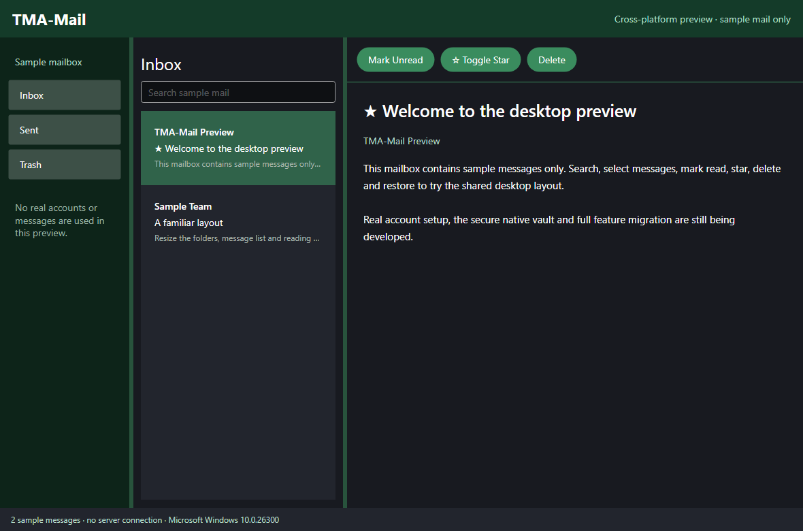

# Mail-KB1 Trying the cross platform preview

Updated 23 October 2026. Applies to source preview 0.17.0-preview.1. The published Windows app remains 0.16.5.

This development preview is the first step towards macOS and Linux support. It contains sample messages and working layout controls. It does not connect to real mailboxes or open your existing Windows profile. Continue using the supported Windows app for real mail.

Build and open it using the commands in [Mail-KB2](Mail-KB2.md). Choose Inbox, Sent or Trash in the left column. Search the sample messages, select one to read, and use Mark Read, Toggle Star or Delete. Delete updates the list immediately. Open Trash and choose Restore to return the message to Inbox. Drag the dividers to resize the panes.

This screenshot comes from the actual Avalonia interface rendered with synthetic messages. macOS/Linux desktop acceptance is not established by this image. Native runner results and remaining release gates are recorded in [PORTABILITY.md](../PORTABILITY.md).

Sample changes are kept only for the current preview session. Restarting recreates the sample mailbox. Account setup, rich composing, safe HTML viewing, calendars, native vaults and desktop integrations still need implementation or target-system validation. See [Mail-KB3](Mail-KB3.md).

[Back to index](kb-registry.json)
