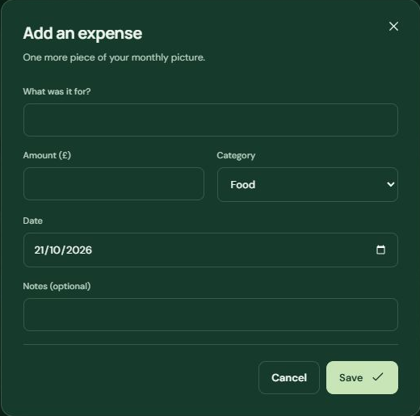

# Finance-KB1: Your workspace and the green interface

Applies to TMA-Finance 0.1.1 and later.

TMA-Finance opens in **Your workspace**, using your personal saved records. A new personal workspace starts empty. Upgrading from 0.1.0 no longer restores the old demo selection; it leaves your personal records and separate sample records intact.

To explore examples, open **Settings & alerts > View demo**. Demo mode is explicitly labelled and lasts for the current session. Select **Use personal**, or reopen the app, to return to your own records. You do not need to reset or delete data to leave demo mode.

The approved green `#163A2B` is used for the sidebar, panels, top bar and dialogs, with deeper green behind them. Text and labels use light colours; highlighted actions use pale green. Forms, date pickers and the desktop theme use dark styling.

This screenshot uses an isolated empty test profile. No personal finance records are shown.

[Back to app guide](../README.md)
